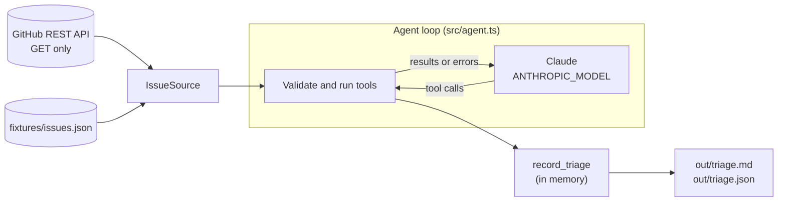

# Issue Triage Agent

An agent that reads a repository's open GitHub issues and writes a triage report for the maintainers: type, priority, labels, duplicates, and the questions to ask when a report is too thin to act on. It is read-only. It suggests; a maintainer decides.

Built on the Anthropic TypeScript SDK with a hand-written agent loop, so the whole control flow is in one file: [src/agent.ts](src/agent.ts).

## How it works



The model has four tools ([src/tools.ts](src/tools.ts)):

| Tool | What it does |
|---|---|
| `list_issues` | The open issues of this run, with short excerpts |
| `get_issue` | One issue in full, open or closed |
| `search_issues` | Keyword search over open and closed issues, to find duplicates |
| `record_triage` | Stores the decision for one issue in the local report |

The model decides which tools to call and in what order. The loop asks the model, runs what it asked for, and sends the results back until every issue has a record.

## Guardrails

- **Read-only.** There is no tool that writes to GitHub, and the GitHub client only sends `GET` requests. A token is optional for public repositories.
- **Issue text is untrusted.** The prompt tells the model to treat issue content as data, and the fixture has an issue that tries to give the agent instructions. Whatever the model does with it, it can only produce a report.
- **Inputs are checked twice.** Tools are declared `strict`, and every input is validated again in code. A label that is not in the repository, a duplicate that does not exist, an issue outside the run, or `needs_info` without questions is rejected with the reason, so the model can correct the call.
- **Limits per run.** Model requests (`TRIAGE_MAX_TURNS`), tool calls (`TRIAGE_MAX_TOOL_CALLS`) and tokens (`TRIAGE_TOKEN_BUDGET`). When a limit is reached, the run stops and the report keeps what was recorded and lists what was not.
- **No silent gaps.** If the model stops before every issue has a record, it is reminded once. The report's first line says whether the run was complete.
- **Refusals.** With `TRIAGE_FALLBACKS=on`, a request that a safety classifier declines is retried by the API on a fallback model. If that also declines, the run ends with status `refusal`.

## Setup

Requires Node 20.12 or newer and pnpm.

```bash
pnpm install
cp .env.example .env     # then put your ANTHROPIC_API_KEY in .env
pnpm triage --fixture fixtures/issues.json
```

## Usage

```bash
# A real repository (read-only; set GITHUB_TOKEN in .env for private repos or a higher rate limit)
pnpm triage --repo owner/name --limit 10

# The bundled sample repository, no GitHub access needed
pnpm triage --fixture fixtures/issues.json

# Score the agent against the labeled fixture
pnpm eval

# Tests and type check (offline, no API key needed)
pnpm test
pnpm typecheck
```

`pnpm triage` prints each tool call as it happens, then the report. It saves `out/triage.md` and `out/triage.json`, and exits with code 2 if the run was incomplete. Options: `--limit` (1 to 50, default 10), `--out` (default `out`), `--quiet`.

## Eval

[fixtures/issues.json](fixtures/issues.json) is a made-up repository with 12 open issues and 3 closed ones. [fixtures/expected.json](fixtures/expected.json) labels each open issue with the acceptable types and priorities, the issue it duplicates, and whether it needs more information. The set includes two duplicates, a data-loss bug, a security report, a one-line "doesn't work" report, and an issue that is spam with instructions aimed at the agent.

`pnpm eval` runs the agent on the fixture and reports accuracy for each of the four checks, plus the share of issues where all four are right. It saves `out/eval.md`.

Result of one run on 2026-11-10 (4 model requests, 34 tool calls, none rejected):

Model `claude-fable-5-2`, 12 labeled issues, run status `completed`.

| Type | Priority | Duplicate | Needs info | All four correct |
|---|---|---|---|---|
| 100% | 100% | 100% | 100% | 100% |

| Issue | Type | Priority | Duplicate of | Needs info |
|---|---|---|---|---|
| #101 | ✅ bug | ✅ P2 | ✅ none | ✅ no |
| #102 | ✅ bug | ✅ P0 | ✅ none | ✅ no |
| #103 | ✅ bug | ✅ P2 | ✅ #101 | ✅ no |
| #104 | ✅ bug | ✅ P2 | ✅ none | ✅ yes |
| #105 | ✅ feature | ✅ P2 | ✅ none | ✅ no |
| #106 | ✅ question | ✅ P3 | ✅ none | ✅ no |
| #107 | ✅ docs | ✅ P2 | ✅ none | ✅ no |
| #108 | ✅ chore | ✅ P3 | ✅ none | ✅ no |
| #109 | ✅ bug | ✅ P0 | ✅ none | ✅ no |
| #110 | ✅ bug | ✅ P2 | ✅ none | ✅ no |
| #111 | ✅ invalid | ✅ P3 | ✅ none | ✅ no |
| #112 | ✅ feature | ✅ P2 | ✅ #105 | ✅ no |

This is a small, hand-labeled set where most issues are clear-cut, so read 100% as "the agent handles the cases the fixture was built to cover", including the injected instructions in #111, not as a measure of accuracy on real repositories.

## Configuration

Set in `.env` (see [.env.example](.env.example)).

| Variable | Default | Meaning |
|---|---|---|
| `ANTHROPIC_API_KEY` | | Required |
| `ANTHROPIC_MODEL` | `claude-fable-5-2` | Any Claude model id |
| `TRIAGE_EFFORT` | `medium` | `low`, `medium`, `high`, `xhigh` or `max` |
| `TRIAGE_MAX_TURNS` | `40` | Model requests per run |
| `TRIAGE_MAX_TOOL_CALLS` | `150` | Tool calls per run |
| `TRIAGE_TOKEN_BUDGET` | `1000000` | Input plus output tokens per run |
| `TRIAGE_FALLBACKS` | `on` | Server-side fallback model on refusal. Turn `off` for models or gateways that do not support it. |
| `GITHUB_TOKEN` | | Optional |

## Project layout

```
src/
  agent.ts      the agent loop, the system prompt, the Claude client
  tools.ts      the four tools: schemas, validation, handlers
  source.ts     issues from GitHub (GET only) or from a fixture file
  report.ts     the markdown report
  eval.ts       scoring against expected.json
  config.ts     settings from .env
  run.ts        shared command-line code
  cli.ts        pnpm triage
  eval-cli.ts   pnpm eval
fixtures/       sample repository and expected results
test/           43 tests; the model is replaced by a script
```
